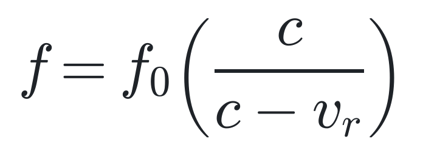
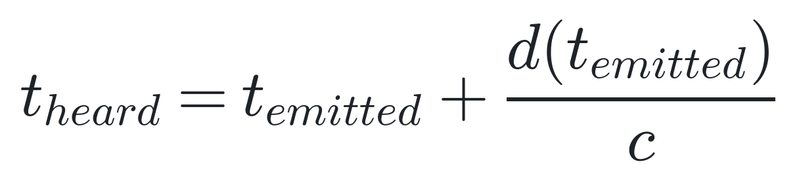
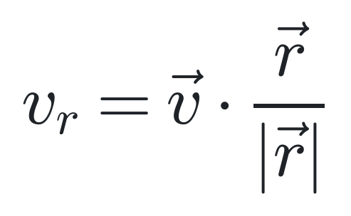

# Acoustic Geolocation via Airplane Doppler Curves

## Overview
This repository contains the logic and algorithmic models for geolocating video or audio recordings using faint, background airplane acoustic signatures. By extracting Doppler curves from audio spectrograms and cross-referencing them with historical ADS-B flight data, we can mathematically pinpoint the exact location where a recording was captured.

The methodology relies on three primary steps:
1. **Audio Analysis:** Extracting temporal events and frequency curves from a recording.
2. **Coarse Filtering (Time/Silence):** Matching time delays between acoustic events to ADS-B data and eliminating candidate locations that should have heard extraneous flights.
3. **Precision Doppler Modeling:** Generating localized, theoretical Doppler curves for remaining grid points and scoring them against the actual spectrogram.

## Core Mathematics

The algorithm fundamentally relies on modeling sound propagation and the Doppler effect. 

### 1. The Doppler Equation
Models the observed frequency of a moving sound source from a stationary observer.

<picture>
  <source media="(prefers-color-scheme: dark)" srcset="docs/images/doppler_equation_dark.png">
  
</picture>

### 2. Sound Propagation Delay
Relates the exact time a sound is heard to the time it was emitted, accounting for the speed of sound and the 3D slant distance.

<picture>
  <source media="(prefers-color-scheme: dark)" srcset="docs/images/propagation_delay_dark.png">
  
</picture>

### 3. Radial Velocity
Calculates the velocity component of the aircraft directed precisely toward the observer.

<picture>
  <source media="(prefers-color-scheme: dark)" srcset="docs/images/radial_velocity_dark.png">
  
</picture>

*Where:*
*   $f$ = Observed frequency on the spectrogram
*   $f_0$ = Fundamental emission frequency of the aircraft engine/propeller
*   $c$ = Speed of sound
*   $v_r$ = Radial velocity of the aircraft relative to the observer
*   $d$ (or $|\vec{r}|$) = 3D slant distance between aircraft and observer at emission time

## Algorithm Pseudocode

```text
FUNCTION GeolocateFromAudio(audio_file, date, rough_search_area):
    // 1. Audio Analysis: Extract Doppler curves from the recording
    spectrogram = generate_spectrogram(audio_file)
    events = find_doppler_curves(spectrogram) // e.g., Event 1 and Event 2
    time_offset = time_difference(events[0], events[1])
    
    // Estimate speed and distance based on curve shape
    v_range_1, dist_range_1 = estimate_parameters(events[0])
    v_range_2, dist_range_2 = estimate_parameters(events[1])

    // 2. Fetch and prep historical flight data
    adsb_data = fetch_adsb_data(date, rough_search_area)
    adsb_data = filter_aircraft_type(adsb_data, "propeller")
    
    // 3. Generate initial candidate points (Coarse Grid)
    dem = load_digital_elevation_model(rough_search_area)
    candidate_points = []
    
    FOR EACH point IN generate_grid(rough_search_area, resolution=200m):
        // Calculate Delayed Closest Point of Arrival accounting for sound travel
        delayed_cpa_1 = get_delayed_cpa(point, adsb_data, v_range_1, dist_range_1, dem)
        delayed_cpa_2 = get_delayed_cpa(point, adsb_data, v_range_2, dist_range_2, dem)
        
        // Time Offset Filter
        IF abs((delayed_cpa_2.time - delayed_cpa_1.time) - time_offset) < error_margin:
            // Silence Filter: Ensure no other planes would be heard between events
            IF count_flights_heard_between(point, adsb_data, delayed_cpa_1, delayed_cpa_2) == 0:
                candidate_points.append(point)

    // 4. Precision Doppler Modeling & Scoring (Fine Grid)
    best_score = 0
    best_location = NULL
    fine_grid = upscale_grid(candidate_points, resolution=100m)
    
    FOR EACH point IN fine_grid:
        flight_1 = get_associated_flight(point, delayed_cpa_1)
        flight_2 = get_associated_flight(point, delayed_cpa_2)
        
        // Generate the exact theoretical Doppler curve
        curve_1 = model_doppler_curve(point, flight_1, events[0].base_freq)
        curve_2 = model_doppler_curve(point, flight_2, events[1].base_freq)
        
        // Score by overlaying modeled curves on actual spectrogram brightness
        score = overlap_score(spectrogram, curve_1, curve_2, lock_temporal_offset=TRUE)
        
        IF score > best_score:
            best_score = score
            best_location = point

    RETURN best_location


FUNCTION model_doppler_curve(point, flight, base_freq):
    modeled_curve = []
    c = speed_of_sound
    
    FOR EACH time t IN duration_of_event:
        // Calculate where the plane was when it PRODUCED the sound heard at time t
        emission_time = t - (distance(flight.position_at(t), point) / c)
        plane_pos = flight.position_at(emission_time)
        
        // Calculate radial velocity
        radial_vel = calculate_radial_velocity(plane_pos, point)
        
        // Doppler Equation
        expected_freq = base_freq * (c / (c - radial_vel))
        modeled_curve.append(time=t, freq=expected_freq)
        
    RETURN modeled_curve
```

## Status

v1 is implemented end to end: audio analysis (`audio/`), ADS-B ingestion (`adsb/`), WGS84/DEM geospatial math (`physics/`), coarse grid filtering and precision Doppler scoring (`grid/`), the `geolocate()` pipeline (`pipeline.py`), and a CLI (`cli.py`). The full test suite (50 tests, spanning unit tests per module plus end-to-end and harness tests) passes. See `CLAUDE.md` for the full architecture writeup, invariants, and known limitations.

## Validation & Algorithm Quality

**Everything below comes from synthetic audio and synthetic/hand-built ADS-B data — the pipeline has not yet been run against a real recording or real historical ADS-B data.** Two complementary synthetic harnesses exercise it, at different scales, for different purposes.

### Ideal, hand-built two-aircraft fixture

`tests/test_pipeline_end_to_end.py` builds one clean, well-separated two-aircraft scenario (synthetic audio generated by a numerical solver independent of the one the pipeline fits against — see `CLAUDE.md` for why that cross-check matters), through the real CLI/pipeline. Across repeated runs with independently-seeded noise:

```
recovered: 47.05016, -122.05046, distance=39.3m, t0_err=0.04s, score=-4.8511
recovered: 47.04971, -122.04980, distance=35.4m, t0_err=-0.16s, score=-4.2753
```

Location recovers to **~35-40m** and the recording's absolute start time (`T0`, itself unknown and solved for jointly with location) to **well under 0.2s**. This demonstrates the pipeline's physics and search logic are internally consistent and correctly implemented — it is not evidence of real-world accuracy, since the "aircraft" here fly exactly the paths the pipeline is later asked to match against.

### Large-scale, randomized validation harness

`scripts/run_validation_harness.py` simulates a couple of days of propeller traffic over a Washington-state-sized airspace (real WA airport locations, curved climb/cruise/descend flight paths), then runs the real pipeline against many randomly-chosen recording trials and reports a breakdown of outcomes (`ok` / `wrong_location` / `insufficient_events` / `no_candidates` / `timeout` / `exception`) instead of a single pass/fail. A small, fixed-seed smoke run (30 flights, 4 trials):

```
ok: 0, wrong_location: 2, insufficient_events: 0, no_candidates: 1, timeout: 1, exception: 0
```

At this tiny scale `0/4 ok` is expected, not a regression — the harness's own test suite doesn't assert otherwise, because a *separate*, deterministic two-flight scenario (routed through the harness's own audio-synthesis code, not a hand-built event list) already proves that code path recovers the truth correctly when the traffic is clean. What the randomized run exercises instead is realistic, often-overlapping traffic, which surfaces two known, pre-existing algorithm limitations rather than harness bugs:

- `audio/events.py::find_doppler_curves` keeps one frequency peak per STFT frame, so two aircraft audible at similar loudness and overlapping in time can't be cleanly separated into two ridges.
- `grid/coarse.py::coarse_filter` costs `O(n_points × n_tracks²)`, so trials with several locally-audible aircraft can exceed the harness's per-trial timeout.

Both are documented in `CLAUDE.md`'s harness section and listed under Remaining Work below. **Bottom line:** the pipeline is solidly validated on *ideal, well-separated* synthetic cases; its hit rate on *dense, overlapping* synthetic traffic, and its accuracy on any real recording, remain open and unmeasured — run `scripts/run_validation_harness.py --n-flights 1000 --n-trials 50` yourself for a current full-scale number rather than trusting a specific rate here, since it isn't tracked as it changes.

## Remaining Work
- [ ] Multi-peak ridge tracking in `audio/events.py`, so two Doppler events overlapping in time/frequency can be separated (currently one frequency peak per STFT frame).
- [ ] Reduce `grid/coarse.py::coarse_filter`'s O(points × tracks²) cost so dense local traffic (common in the validation harness) doesn't time out.
- [ ] Real ICAO aircraft-type lookup, replacing the local ADS-B dump's explicit `is_propeller` column.
- [ ] Validate against real recordings and real historical ADS-B data (all current numbers are synthetic).
- [ ] Geoid-undulation correction (v1 treats barometric/orthometric/ellipsoidal heights as equivalent).
